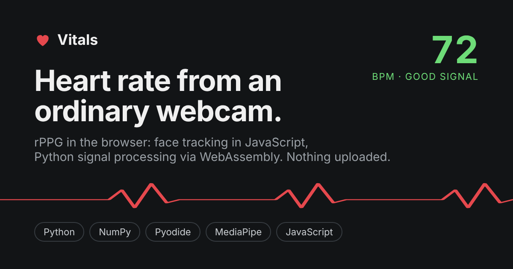
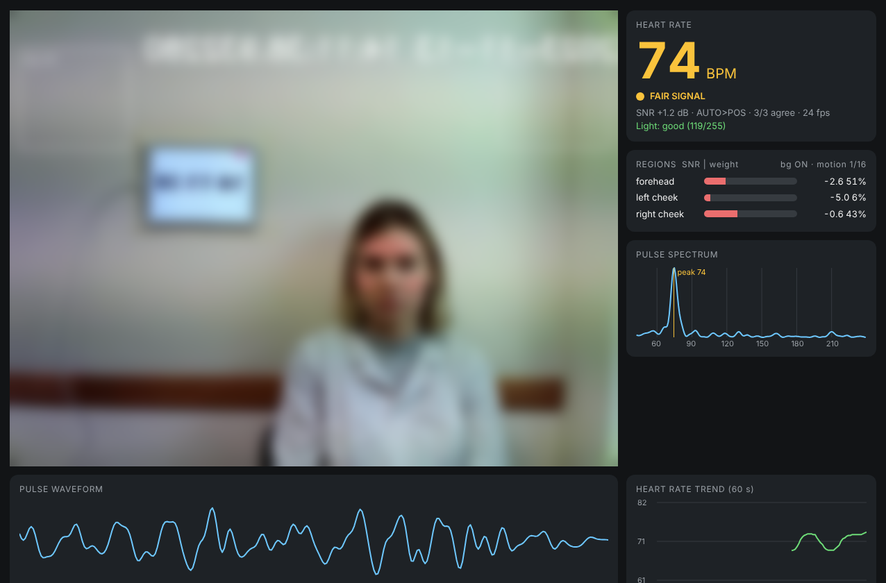
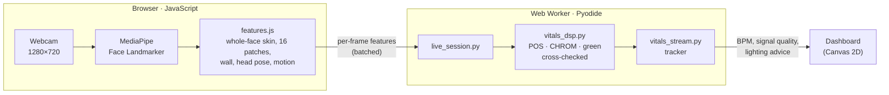
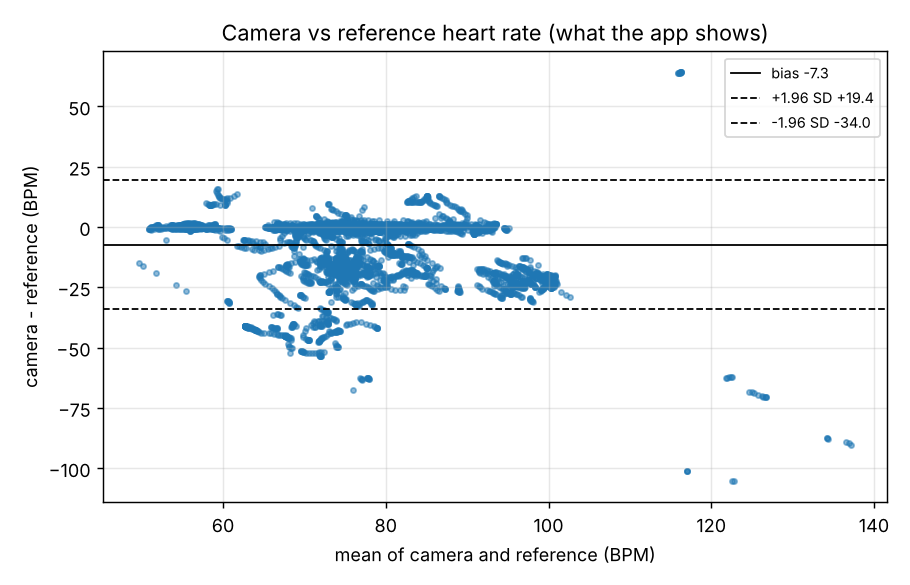

<div align="center">

# Vitals

**Heart rate from an ordinary webcam, measured entirely in your browser.**

[](https://vitals-track.vercel.app)
[](https://github.com/aboodgitawaida/Vitals/actions/workflows/ci.yml)

[](LICENSE)

[**Try it live →**](https://vitals-track.vercel.app)

<a href="https://vitals-track.vercel.app"></a>

</div>

Each heartbeat pushes blood into the skin and changes its colour very slightly,
far too little to see. Vitals tracks your face, measures that colour across
the skin of the whole face, removes what room light explains, and recovers your
pulse. This technique is called **remote photoplethysmography (rPPG)**.

There are two front ends over one signal-processing core:

* **Web app** ([vitals-track.vercel.app](https://vitals-track.vercel.app)):
  face tracking in JavaScript, and the project's **own Python analysis running
  unchanged in the browser** through Pyodide (WebAssembly). No server, no uploads.
* **Desktop app** (`vitals_app.py`): OpenCV dashboard with recording, replay
  and a liveness-check prototype.

**Tested on real people:** on held-out recordings from the public
[MCD-rPPG](https://huggingface.co/datasets/kyegorov/mcd_rppg) dataset, 65% of the
readings Vitals shows are within 5 BPM of a finger pulse sensor (average error 8.4 BPM).
On 7 of 32 test recordings it averages within 1 BPM; on about half it is still off by
more than 10 BPM per window, and the display hides many of those readings rather than
fixing them. Evaluating on real data led to a redesign that cut the per-window error by
about 30% on the development set and 20% on the test set; the numbers, what changed and
what is still wrong are in [Validation](#validation).

> Not a medical device. Not for health, stress or diagnostic use.

<p align="center"><br>
<sub>The web app reading a real recording through a virtual camera: 74 BPM, finger sensor 73-77 BPM. Face blurred; video from MCD-rPPG (CC BY 4.0).</sub></p>

## Highlights

* **One Python codebase, two runtimes.** The analysis (`live_session.py`,
  `vitals_dsp.py`, `vitals_stream.py`) runs natively on desktop and in a Web
  Worker in the browser. A build step finds every module it imports and ships
  only those. scipy is replaced in the browser by `signal_lite.py` (numpy-only
  Butterworth, filtfilt and detrend, verified against scipy in tests), which
  halves the download.
* **Signal processing driven by real data.** The pulse is measured on the
  whole face, with room-light changes removed using the background wall as a
  reference, and three rPPG methods (POS, CHROM, green) must agree before a
  number is trusted. Evaluating on real recordings changed the design: see
  [What real data changed](#what-real-data-changed).
* **Honest by design.** A tracker (acquiring / locked / holding / lost) shows
  "--" instead of guessing when the signal is weak. The README documents the
  skin-tone gap and what the project deliberately does **not** measure.
* **Fast first reading.** The camera and face tracking start before Python has
  loaded, and measured frames are queued and analysed when it is ready. First
  visit at 20 Mbit/s: camera in ~4 s, first heart rate in ~12 s.
* **Evaluated on real data, with a held-out test set.** A reproducible
  evaluation on random samples of a public research dataset (see
  [Validation](#validation)): standard rPPG metrics (MAE, RMSE, Pearson r,
  Bland-Altman), a development set used to fix the method and a separate test
  set used only to report it, a comparison with the published baseline, and
  the failure cases.
* **Tested.** 81 unit and end-to-end tests run in GitHub Actions on every push,
  including a check that the JavaScript colour measurement matches the Python
  one and simulated 2-minute sessions that test what the screen actually shows.
* **Private.** Video never leaves the device. Recordings store per-frame
  average colours only, never images.

## Architecture



The desktop app uses the same Python modules, with OpenCV and MediaPipe
FaceMesh instead of the browser front end. The full per-frame pipeline:

```
webcam 1280x720 -> FaceMesh on a 640-wide copy (fast)
       -> mean colour of the whole face at full resolution (outline minus eyes,
          brows and lips; glare dropped), plus 16 small patches for the SNR map
       -> rolling 15 s buffer (bridges face-detection gaps < 1 s, blanks fast-motion frames)
       -> nuisance regression: remove what the background wall (room light) explains
       -> POS (green only if its spectrum is clearly cleaner, by 6 dB)
       -> 0.7-4 Hz band -> FFT peak with harmonic check -> SNR
       -> cross-check: POS, CHROM and green each find their own peak; if no
          second method agrees (within 5 BPM) the estimate is not trusted
       -> tracker: acquiring / locked / holding / lost -> dashboard
          (first estimate after 5 s, with a stricter bar for short windows)
```

## Tech stack

| Area | Tools |
| --- | --- |
| Signal processing | Python, NumPy, SciPy (desktop) / `signal_lite.py` (browser) |
| Computer vision | MediaPipe Face Landmarker (web), MediaPipe FaceMesh + OpenCV (desktop) |
| Web | Vanilla JavaScript (ES modules), Web Workers, Pyodide, Canvas 2D, no framework |
| Testing and CI | pytest, Node (JS/Python parity test), GitHub Actions |
| Hosting | Vercel (static build: `node web/build.mjs`) |

## Run it

### In the browser

Open [vitals-track.vercel.app](https://vitals-track.vercel.app) and click
**Start camera**. To run it locally:

```bash
node web/build.mjs                         # assembles dist/ (page + the .py files it needs)
cd dist && python -m http.server 8000      # open http://localhost:8000
```

Keys: `M` method · `B` background cancellation · `L` light mode · `R` patch SNR map · `P` performance.

Deploying: `vercel.json` sets the build command and output folder, so importing
the repo at vercel.com/new needs no configuration.

### Desktop app

```bash
conda create -n vitals python=3.11 -y      # MediaPipe needs Python 3.9-3.12
conda activate vitals
pip install -r requirements.txt
python vitals_app.py
```

Options: `--res 640x480`, `--no-motion-correction`, `--no-background` (run the
analysis inline instead of in a background process).

Keys: `v` liveness check, `q` quit, `m` method (auto / pos / green), `b`
background cancellation, `l` light mode (white full-screen so the screen lights
your face), `r` patch SNR map, `p` performance readout, `s` start/stop recording
(average colours per frame only, never images).

### Tests and benchmarks

```bash
pip install -r requirements-dev.txt
python -m pytest -q tests

python replay.py recordings/session_YYYYMMDD_HHMMSS.csv --ref 72   # 72 = your watch's BPM
python session_benchmark.py              # simulated sessions: v3 vs v4 vs v5, still and fidgeting
python session_benchmark.py --start      # how fast and how right is the first number?
python session_benchmark.py --vanish     # does the number disappear when the pulse does?
python session_benchmark.py --calibrate  # how often pure noise passes the thresholds

node web/build.mjs && node tests/browser_check.mjs cam.y4m   # the web app, with a video file as the webcam
```

## Project structure

| File | What it does |
| --- | --- |
| `vitals_app.py` | Live app: camera, FaceMesh, dashboard, recording |
| `live_session.py` | The live app's heart-rate logic without camera or UI (shared with the web version) |
| `signal_lite.py` | numpy-only butter / filtfilt / detrend, so the browser needn't download scipy |
| `face_layout.py` | Face regions, patch grid, thresholds, lighting coach (no OpenCV, so the browser can use it) |
| `web/` | Browser version (Vercel): camera + MediaPipe in JS, the Python analysis via Pyodide |
| `vitals_dsp.py` | All signal processing (no camera code, fully testable) |
| `frame_features.py` | Per-frame skin colours, wall, head pose and motion, shared by the app and the video tools |
| `evaluate_video.py` | Accuracy on videos with a reference (MCD-rPPG, UBFC-rPPG, test videos, your own clips) |
| `fetch_mcd_rppg.py` | Downloads a random, reproducible sample of the public MCD-rPPG dataset for `evaluate_video.py` |
| `make_test_video.py` | Turns a selfie into a test video with a known heart rate |
| `vitals_stream.py` | Rolling buffer and display tracker, shared by app, replay and benchmarks |
| `face_regions.py` | Skin regions, patch grid, skin filter, background boxes, lighting coach |
| `dashboard.py` | OpenCV UI, dark and light themes |
| `perf.py` | Stage timer and background analysis process (keeps the camera loop smooth) |
| `liveness.py` | Liveness check prototype: pulse check + random screen-flash challenge; re-scores saved attempts |
| `liveness_benchmark.py` | Simulated real people vs attacks (photo, mask, phone replay, virtual camera, live deepfake) |
| `replay.py` | Re-runs every configuration on a recording against a reference BPM |
| `synthetic_benchmark.py` | Per-window ablation on simulated lighting scenarios |
| `session_benchmark.py` | End-to-end test of what the screen shows on simulated 2-minute sessions |
| `tests/` | Unit and end-to-end tests (run in CI on every push) |

## How the web version works

The camera, face tracking (MediaPipe Face Landmarker) and the skin-patch
colours run in JavaScript. The analysis is **this repo's Python**, run
unchanged in a Web Worker with [Pyodide](https://pyodide.org), so the camera
view never waits for it. The page downloads its code and the face model
(~16 MB the first time, cached after), starting while the visitor reads the
intro.

* Face tracking loads first and measuring starts right away. Python loads
  during the first 5 s of collecting, then analyses everything measured so far.
* `web/face_layout.json` (generated by `python face_layout.py >
  web/face_layout.json`, and checked by a test) gives the page the face regions
  without waiting for Python.
* scipy is not loaded in the browser. `vitals_dsp` falls back to
  `signal_lite.py`, numpy versions of the three scipy functions it uses.
* On machines with software-only graphics, face tracking goes straight to CPU.

Not in the web version yet: the liveness check and recording.

## Validation

Accuracy is measured the way rPPG research does it: run the pipeline on
videos recorded together with a contact sensor and compare, window by window.

### Results on real people (MCD-rPPG)

[MCD-rPPG](https://huggingface.co/datasets/kyegorov/mcd_rppg) (Egorov et al.,
*Gaze into the Heart*, ACM Multimedia 2025, CC BY 4.0) is a public dataset of
600 people filmed for 3 minutes at rest and again after exercise, with a
finger PPG sensor recorded at the same time. Vitals runs on the frontal
webcam (640×480, 30 fps). People are drawn at random with a fixed seed, both
sessions each, into two separate sets:

* **development set** (seed 0): 15 people, 30 recordings. Used to find and
  fix problems.
* **test set** (seed 1): 16 other people, 32 recordings. Never looked at
  while changing the method; the numbers below are its first and only run.

```bash
python fetch_mcd_rppg.py --subjects 15 --seed 0 --out mcd_dev     # ~2.4 GB
python fetch_mcd_rppg.py --subjects 16 --seed 1 --out mcd_test
python evaluate_video.py mcd_test --jobs 4
```

**Held-out test set, what the app shows** (tracker on, number on screen vs the sensor, every second):

| Coverage (a number is shown) | MAE | RMSE | Pearson r | Within 5 BPM |
| --- | --- | --- | --- | --- |
| 50% | 8.4 BPM | 15.5 BPM | 0.48 | 65% |

**Every 15 s window, before and after the changes below** (no tracker, the
usual way rPPG papers report):

| Set | Method | MAE (BPM) | RMSE (BPM) | Pearson r | Within 5 BPM | Recordings under 5 BPM |
| --- | --- | --- | --- | --- | --- | --- |
| development | before (16 patches) | 12.50 | 20.44 | 0.44 | 51% | 7 / 30 |
| development | **after (whole face)** | **8.69** | **15.81** | **0.59** | **61%** | **12 / 30** |
| test | before (16 patches) | 13.49 | 21.11 | 0.24 | 47% | 8 / 32 |
| test | **after (whole face)** | **10.89** | **18.20** | **0.34** | **54%** | **13 / 32** |

<p align="center"></p>

Full tables (every method, at rest vs after exercise) and per-recording
results: [`docs/validation/`](docs/validation/). The reference heart rate is
the spectral peak of the sensor's waveform over the same 15 s window.

### What real data changed

The first run on real recordings (development set) was far worse than the
simulations had suggested, so each part of the pipeline was checked against
it:

1. **Measure the whole face, not 16 small patches.** In failing recordings
   the true heart rate was often not even among the top three spectral
   peaks, so better peak picking could not help: the signal itself was too
   weak. On a 640×480 face each patch averages few pixels, and its edges move
   with every pixel of landmark jitter. One region (face outline minus eyes,
   brows and lips) cut the per-window error from 12.5 to 8.7 BPM. The browser
   and Python measure it with the same scanline fill, so they agree exactly.
2. **No head-motion correction on the face signal.** It made real results
   worse even with a stricter trigger: with people sitting still it removed
   more pulse than motion (the head moves very slightly with every beat).
3. **POS by default.** Auto mode used to switch to the green channel whenever
   its spectrum looked cleaner; on real data that was rarely right, so green
   now has to be clearly better (6 dB).
4. **Too-dark patches are skipped.** One test-set person's forehead patches
   were nearly black (hair), and dividing by a near-zero colour crashed the
   analysis. Found by the held-out run, fixed, and covered by a test.

Things that did **not** help and were left out: a stricter tracker (it hid
more readings, but the share of wrong ones stayed the same), penalising
frequencies seen on the background wall, and different patch weightings.

**Where it still fails.** A third of the development recordings and half of
the test recordings are still off by more than 10 BPM per window on average.
Many lock onto a strong periodic component that is not the pulse (e.g. person 3196: ~62 BPM on every
part of the face, while the finger sensor reads 75-80 and an ECG 73). Being
confidently wrong is the remaining problem, so the next step is detecting
these artefacts rather than raising thresholds. The dataset's paper reports
3.8 BPM for plain POS on this camera (their protocol, not 15 s windows), so
the gap is narrower but not closed.

### Synthetic test videos

```bash
python make_test_video.py selfie.jpg --bpm 72          # known-BPM test video from a photo
python evaluate_video.py test_videos/selfie_72
python evaluate_video.py my_clip.mp4 --ref-bpm 68      # your own clip + a watch reading
```

The full video pipeline (decoding, compression, frame features, analysis,
tracker) recovers a known heart rate from synthetic test videos with under
0.2 BPM error, including head sway and in-band lamp flicker. In the flicker
video, single methods failed in different ways (POS locked onto the flicker
without wall cancellation; CHROM with it) while the full pipeline stayed
correct: that is why the three methods are cross-checked.

### The web app on a real video

`tests/browser_check.mjs` runs the built web app in headless Chromium with a
dataset video as the webcam, so the browser path (MediaPipe in JavaScript,
Python in Pyodide, the dashboard) is checked on real footage too. On subject
1020 at rest it showed 68-75 BPM ("good signal") while the sensor read
73-77 BPM.

## What this project deliberately does not measure

* **Blood pressure.** Claims exist, but without credible evidence that it
  works across the full range; a dataset of mostly normal readings makes
  any method look accurate.
* **Blood oxygen (SpO2).** Needs calibrated measurements at specific
  wavelengths; a consumer webcam's RGB filters are not that.
* **Heart-rate variability (HRV).** Standard HRV uses 5-minute recordings,
  and at 30 fps beat timing is only accurate to ~33 ms, the same order as
  the beat-to-beat differences HRV measures.
* **Stress, emotion, lying.** Heart rate changes for many reasons;
  inferring mental states from it is not scientifically established.

## Privacy

Everything runs on your device. Recordings, liveness attempts and the
evaluation cache store per-frame average colours only, never images. If you
record other people, tell them the video is analysed for heart rate and get
their consent.

## Liveness check (prototype)

Press `v`. **Step 1** (10-30 s): the screen turns white and the app looks for
a pulse that shows up across the forehead and both cheeks. **Step 2** (~7 s):
the screen flashes a random colour sequence, decided only when the check
starts, and the app checks that the skin's tint follows it within a fraction
of a second.

| Attack | Pulse check | Flash challenge | Result |
| --- | --- | --- | --- |
| Printed photo, mask | no pulse | reflects | never LIVE |
| Phone replaying a video | has a pulse | only glints in 1-3 spots | NOT LIVE |
| Video injected as a virtual camera | has a pulse | never sees the screen | NOT LIVE |
| Real-time face swap of a real person | carried through | carried through | **not caught (blind spot)** |

Simulated results (`python liveness_benchmark.py`, 60 attempts per scenario):
0% of photo / mask / replay / virtual-camera attacks accepted, 0% of real
people called NOT LIVE, typical time to confirm 10 s. Real people confirmed
LIVE, by skin tone and room light:

| | bright | normal | dim |
| --- | --- | --- | --- |
| lighter | 100% | 100% | 100% |
| medium | 100% | 100% | 67% |
| darker | 100% | 15% | 0% |

**Design choice:** a weak pulse can stop a LIVE result but never produces
NOT LIVE. The first version turned "weak" into "fake" and rejected every
simulated darker-skinned person in normal light; now they get NOT CONFIRMED
with advice to add light. NOT LIVE is reserved for strong physical evidence
(the face did not react to the flashes).

Attempts are saved as colours only (`recordings/liveness_*`) and can be
re-scored: `python liveness.py recordings/liveness_YYYYMMDD_HHMMSS`.
This is a research prototype, not a security product; real attacks (a good
OLED phone, a matte photo under a lamp) still need testing in person.

## Known limitations

* **Skin tone.** Melanin absorbs light, so darker skin reflects a weaker pulse
  signal. In simulation, darker skin gets a number on screen far less often
  (it shows "--" rather than guessing). This is a known weakness of camera-based
  rPPG generally, not just this project. How large the gap is in practice will
  be measured with real recordings (see [Roadmap](#roadmap)).
* **Lighting and motion.** Dim light raises camera noise; movement corrupts the
  signal. The app tells you which one it sees, and it refuses to show a number
  when the signal is too weak.
* **Movement.** Head-pose motion correction exists (`analyze_heart_rate`,
  per patch) but is not applied to the whole-face signal: on real recordings
  of people sitting still it removed more pulse than motion, likely because
  the head moves very slightly with every heartbeat (ballistocardiography).
  Large turns, talking with big jaw movement and walking are out of scope.
* **Lag.** The number describes roughly the last 15 seconds, so it reacts to
  changes with a delay of several seconds.
* **One real dataset so far.** The real-data numbers come from one recording
  setup (one room and lighting, people sitting still, recorded in one country). The
  simulated benchmarks generate data from the same physics the methods
  assume, which flatters them; they test that the code does what it is
  designed to do, not accuracy.

## Roadmap

* **Detect non-pulse periodic artefacts** (the remaining failure mode, see
  [Validation](#validation)), then the full MCD-rPPG set (600 people, three
  cameras), UBFC-rPPG, dim rooms and a wider range of skin tones.
* **Breathing rate** from the same signal (0.1-0.5 Hz band).
* Liveness check and recording in the web version.

## Author

**Abood Awaida** · [GitHub](https://github.com/aboodgitawaida) · [LinkedIn](https://www.linkedin.com/in/abood-awaida/)

## More of my work

- **[Courseflix](https://github.com/aboodgitawaida/Courseflix)**: Netflix-style course discovery for UTM students, with reviews, recommendations and 2,600+ courses. [courseflix.ca](https://www.courseflix.ca)
- **[LotPulse](https://github.com/aboodgitawaida/LotPulse)**: live, student-reported parking enforcement alerts for UTM campus lots. [lotpulse-utm.vercel.app](https://lotpulse-utm.vercel.app)
- **[Basil](https://github.com/aboodgitawaida/Basil)**: a cosy pixel-art kitchen game that suggests recipes from what's in your fridge. [basil-cat.vercel.app](https://basil-cat.vercel.app)

## License

[MIT](LICENSE)
