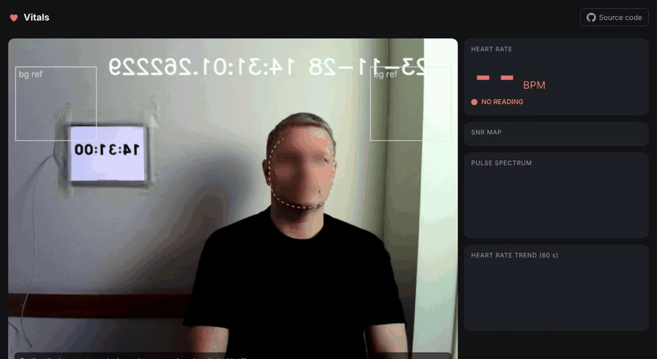
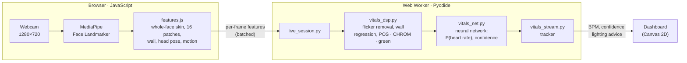
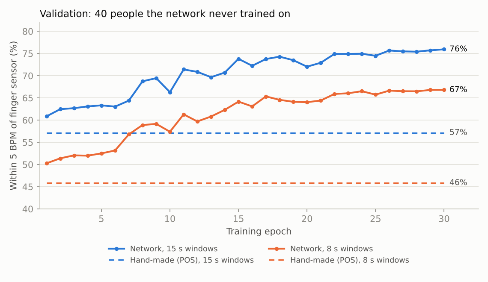
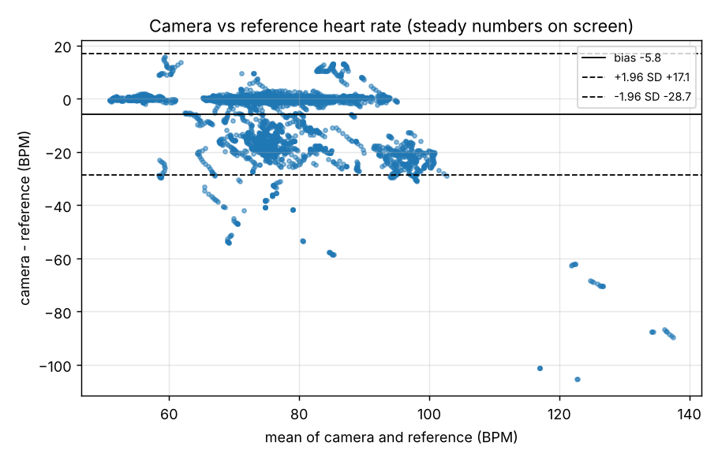

<div align="center">

# Vitals

**Heart rate from an ordinary webcam, measured entirely in your browser.**

[](https://vitals-track.vercel.app)
[](https://github.com/aboodgitawaida/Vitals/actions/workflows/ci.yml)

[](LICENSE)

[**Try it live →**](https://vitals-track.vercel.app)

<a href="https://vitals-track.vercel.app"></a>

<sub>The web app reading a recording of a person the network never trained on (MCD-rPPG test split,
typical accuracy for that split) through a virtual camera: 67-72 BPM; the finger pulse sensor read 64-68.
A new number is dimmed ("settling") until it is steady; the chart is the network's probability for every heart rate.
Dashed line: the skin it measures. Face blurred for privacy.</sub>

</div>

Each heartbeat pushes blood into the skin and changes its colour very slightly,
far too little to see. Vitals tracks your face, measures that colour across
the skin of the whole face and in 16 patches, and a small neural network,
trained on 400 people filmed alongside a finger pulse sensor, turns it into a
heart rate and says how sure it is. This technique is called **remote
photoplethysmography (rPPG)**.

## At a glance

| | |
| --- | --- |
| **What** | Camera-based heart rate (rPPG) that runs in the browser. No server, no uploads. |
| **How** | MediaPipe face tracking in JavaScript; a neural network ([`vitals_net.py`](vitals_net.py), 74k weights, trained in PyTorch, run in numpy) and the project's own Python signal processing run unchanged in a Web Worker through Pyodide (WebAssembly). The same Python powers a desktop app. |
| **Accuracy** | Tested against a finger pulse sensor on 200 recordings of 100 people the network never saw ([MCD-rPPG](https://huggingface.co/datasets/kyegorov/mcd_rppg)): **90% of 15 s readings within 5 BPM** (average error 2.3 BPM), against 77% (7.1 BPM) for the hand-made pipeline it replaced. A steady number is on screen 90% of the time, and 92% of those are within 5 BPM. The first number appears after a median of **7 s** (was 10 s). [Details](#validation) |
| **Engineering** | Dataset pipeline over 540 people with person-level train / validation / test splits; bootstrap confidence intervals by person; one codebase, two runtimes; tests that numpy matches PyTorch and that JavaScript and Python measure the same pixels; 110 tests and a linter in CI. |
| **Honesty** | The network's confidence is calibrated (when it says 90%+, it is right 98% of the time), so the app shows "--" instead of guessing; failure cases are published, and so is what it deliberately does not measure. |

> Not a medical device. Not for health, stress or diagnostic use.

## Highlights

* **A neural network that knows when it is right.** A small network (74k
  weights), trained on 400 people filmed next to a finger pulse sensor,
  turns skin colour into a probability for every heart rate. On 100 held-out
  people it is within 5 BPM in 90% of 15 s windows, against 77% for the
  hand-made pipeline it replaced, and when it says it is 90%+ sure it is
  right 98% of the time. So the app shows a number after 7 s and shows "--"
  rather than guess. It runs in the browser in numpy: one update, network
  included, takes ~150 ms. See [The model](#the-model).
* **A data bug that hid a quarter of the accuracy.** Numbers on the
  dataset's side cameras looked too bad to believe, so the timing was
  checked against the per-frame timestamps: 29% of the videos say 24 fps in
  their header but were filmed at 30. Every tool had trusted the header, so
  for those people the pulse looked 20% slower than the sensor said, in
  training labels and test references alike. Fixing it took held-out
  accuracy from 72% to 90%.
* **Built for real rooms, not just the dataset.**
  * **Turned faces.** The network learned from all three of the dataset's
    camera angles, not just the front one: on held-out people seen from the
    side, 68% of windows are within 5 BPM (was 59-63%), and the steady
    numbers it shows there are right 87% of the time (was 77-79%), with
    the front unchanged.
  * Mains-powered lights flicker, and dropped frames turn that flicker into
    a fake pulse (87 BPM read as ~110). `vitals_dsp.deflicker` removes it:
    with 30% of frames dropped, 86% of windows are within 5 BPM instead of 78%.
  * **Two people in view** no longer mixes their pulses. The app follows
    one face (the green outline), keeps the wall reference off the other,
    and a tap switches person.
  * A framing coach says when the face is cut off, too small or tilted;
    short face losses (up to 3 s) are bridged instead of starting over.
  * "Save session data" stores what the page measured (colours only, no
    images). `replay_session.py` replays it frame for frame and reproduces
    the browser's screen exactly, so a bad session can be debugged without
    the person.
* **One Python codebase, two runtimes.** The analysis runs natively on
  desktop and in a Web Worker in the browser through Pyodide. A build step
  ships only the modules it imports, and scipy is replaced by a numpy-only
  `signal_lite.py` (checked against scipy in tests), which halves the download.
* **Honest by design.** Person-level train / validation / test splits;
  every threshold chosen on validation people only; 95% intervals that
  resample people; failure cases and weak spots (side views, dim rooms,
  skin tone) are published, and so is what it deliberately does not measure.
* **Tested.** 110 tests and a linter run in GitHub Actions on every push,
  including numpy-vs-PyTorch parity of the network, JavaScript/Python
  parity of the pixel measurement and the face lock, and simulated 2-minute
  sessions that test what the screen shows. `tests/browser_check.mjs` runs
  the real web app in headless Chromium on a dataset video.
* **Private.** Video never leaves the device.

## Architecture



The desktop app uses the same Python modules, with OpenCV and MediaPipe
FaceMesh instead of the browser front end. The full per-frame pipeline:

```
webcam 1280x720 -> FaceMesh on a 640-wide copy (fast)
       -> mean colour of the whole face at full resolution (outline minus eyes,
          brows and lips; glare dropped), plus 16 small patches for the SNR map
       -> rolling 15 s buffer (bridges face-detection gaps < 1 s, blanks fast-motion frames)
       -> if frames were dropped: fit and remove light flicker at the true frame times
       -> neural network (vitals_net.py) on face + 16 patches + wall:
          probability for every heart rate 40-180 BPM -> peak = estimate,
          probability within 5 BPM of it = confidence; plus a pulse waveform
       -> tracker: acquiring / locked / holding / lost -> dashboard
          (first estimate after 6 s of data; a new number is shown dimmed as
          "settling" until it has lasted 6 s and the network is 80% sure)
```

The hand-made pipeline (wall regression, POS, FFT peak, SNR, three methods
cross-checked) still runs: its spectrum and method agreement are on the
dashboard, the **Classic** button uses it, and it is the fallback if the
weights are missing.

## The model

**Why.** On real recordings the hand-made pipeline was often confidently
wrong: strong periodic components in the video locked its estimate, and no
hand-written check (SNR, agreement between methods or face regions,
stability, peak dominance) told right readings from wrong ones. That is a
pattern-recognition problem, so a network learns it from examples.

**Data.** [MCD-rPPG](https://huggingface.co/datasets/kyegorov/mcd_rppg)
(CC BY 4.0): people filmed for 3 minutes at rest and after exercise, with a
finger PPG sensor synchronised to every frame. `build_mcd_dataset.py`
downloads each recording, extracts the per-frame features exactly as the
app measures them, keeps those (~1 MB) and deletes the video: the frontal
webcam for 540 people (1,080 recordings, ~5 h on 4 CPU cores) and the left
and right cameras for the training people and some of the others. Frame times come from
the dataset's per-frame timestamps, not the video header (wrong for 29% of
the videos). People are split once,
with a fixed seed, so no person is in two sets:

| Split | People | Recordings | Used for |
| --- | --- | --- | --- |
| train | 400 | 2,387 (3 camera angles) | training |
| validation | 40 | 80 | choosing the model, its size, the tracker thresholds and the start time |
| test | 100 | 200 front, 198 side (50 people) | final runs only, after everything was fixed ([every run listed](docs/validation/net_test/summary.md)) |

**Network** (74k weights, numpy at inference):

```
input, 6-15 s window at 30 Hz, 75 channels:
  RGB of the whole face, 16 skin patches and the background wall (relative change, band-passed)
  + POS, CHROM and green signals of the face (hand-made hints)
  + a flag per trace for "missing"
-> 1x1 colour mixing (a learned, many-channel POS)
-> 5 residual blocks of dilated temporal convolutions (dilation 1-16)
-> waveform head: the pulse (trained to match the finger PPG, Pearson loss)
-> spectral head: FFT of every feature channel, mapped onto a 40-180 BPM grid,
   mixed across channels and neighbouring bins -> softmax over heart rates
   (trained with cross-entropy against a Gaussian around the PPG's heart rate)
```

**Training** (`train_net.py`, PyTorch on CPU, 30 epochs, ~2 h): random
windows of 6-15 s; time-stretching of input and PPG together (heart rates
~45-170 BPM although most people here were 60-120), colour gains, camera
noise, coloured light flicker added to face and wall alike (so the network
learns that what the wall does is not a pulse), and dropped patches.
BatchNorm is folded into the convolutions at export; a test checks that the
numpy forward pass matches PyTorch to 1e-4 on a committed fixture.

<p align="center"></p>

**Confidence you can use.** On the test split, the network's confidence
matches how often it is right:

| Network confidence | 15 s windows | Within 5 BPM of the sensor |
| --- | --- | --- |
| below 30% | 121 | 31% |
| 30-50% | 518 | 46% |
| 50-70% | 805 | 58% |
| 70-90% | 1330 | 85% |
| 90% and above | 8227 | **98%** |

The tracker shows a number from 40% confidence, keeps it above 30%, and
marks it steady at 80% ([`docs/model/tracker_validation.md`](docs/model/tracker_validation.md):
the sweep, on validation people only).

**Reproduce:**

```bash
pip install -r requirements-train.txt
python build_mcd_dataset.py --out mcd_features --jobs 4                  # ~5 h, ~1.3 GB kept
python build_mcd_dataset.py --out mcd_left --camera USBVideo --splits mcd_features/splits.json    # side cameras
python build_mcd_dataset.py --out mcd_right --camera IriunWebcam --splits mcd_features/splits.json
python train_net.py --data mcd_features --data mcd_left --data mcd_right --workers 1   # ~2.5 h
python tune_tracker.py --data mcd_features                                # tracker thresholds (validation)
python compare_net.py --data mcd_features --split test --out docs/validation/net_test
python dropped_frames.py --data mcd_features                              # flicker vs dropped frames
python hard_conditions.py --cond front=mcd_features --cond left=mcd_left ...  # side cameras, chin cut off
```

## Tech stack

| Area | Tools |
| --- | --- |
| Machine learning | PyTorch (training, CPU), numpy inference in the browser |
| Signal processing | Python, NumPy, SciPy (desktop) / `signal_lite.py` (browser) |
| Computer vision | MediaPipe Face Landmarker (web), MediaPipe FaceMesh + OpenCV (desktop) |
| Web | Vanilla JavaScript (ES modules), Web Workers, Pyodide, Canvas 2D, no framework |
| Testing and CI | pytest, ruff, Node (JS/Python parity test), Playwright (browser check), GitHub Actions |
| Hosting | Vercel (static build: `node web/build.mjs`) |

## Run it

### In the browser

Open [vitals-track.vercel.app](https://vitals-track.vercel.app) and click
**Start camera**. To run it locally:

```bash
node web/build.mjs                         # assembles dist/ (page + the .py files it needs)
cd dist && python -m http.server 8000      # open http://localhost:8000
```

Keys: `M` method · `B` background cancellation · `L` light mode · `R` patch SNR map · `P` performance · `D` save session data.

**When it gets it wrong on you:** type your real heart rate (from a watch) next to
**Save session data** and press it. The file holds the per-frame average skin and
wall colours, head pose and what the screen showed: no images, and nothing is
uploaded. `python replay_session.py vitals_session_*.json.gz` then replays it through
the exact same code, frame batch by frame batch, and shows why the app did what it
did: when the face was lost or framed badly, every start-over and its cause, what
the network and the hand-made pipeline each read, and the error against your
real heart rate.

Deploying: `vercel.json` sets the build command and output folder, so importing
the repo at vercel.com/new needs no configuration.

### Desktop app

```bash
conda create -n vitals python=3.11 -y      # MediaPipe needs Python 3.9-3.12
conda activate vitals
pip install -r requirements.txt
python vitals_app.py
```

Options: `--res 640x480`, `--no-motion-correction`, `--no-background` (run the
analysis inline instead of in a background process).

Keys: `v` liveness check, `q` quit, `m` method (auto / classic / pos / green), `b`
background cancellation, `l` light mode (white full-screen so the screen lights
your face), `r` patch SNR map, `p` performance readout, `s` start/stop recording
(average colours per frame only, never images).

### Tests and benchmarks

```bash
pip install -r requirements-dev.txt
python -m pytest -q tests
ruff check .

python replay.py recordings/session_YYYYMMDD_HHMMSS.csv --ref 72   # 72 = your watch's BPM
python session_benchmark.py              # simulated sessions: v3 vs v4 vs v5, still and fidgeting
python session_benchmark.py --start      # how fast and how right is the first number?
python session_benchmark.py --vanish     # does the number disappear when the pulse does?
python session_benchmark.py --calibrate  # how often pure noise passes the thresholds

node web/build.mjs && node tests/browser_check.mjs cam.y4m   # the web app, with a video file as the webcam
```

## Project structure

| File | What it does |
| --- | --- |
| `vitals_app.py` | Live app: camera, FaceMesh, dashboard, recording |
| `live_session.py` | The live app's heart-rate logic without camera or UI (shared with the web version) |
| `signal_lite.py` | numpy-only butter / filtfilt / detrend, so the browser needn't download scipy |
| `face_layout.py` | Face regions, patch grid, thresholds, lighting coach (no OpenCV, so the browser can use it) |
| `web/` | Browser version (Vercel): camera + MediaPipe in JS, the Python analysis via Pyodide |
| `vitals_dsp.py` | All signal processing (no camera code, fully testable) |
| `vitals_net.py` | The neural network: input preparation and numpy inference (runs in the browser) |
| `vitals_net_weights.npz` | Its trained weights (280 KB) |
| `train_net.py` | Trains it in PyTorch on the train split, selects on validation |
| `build_mcd_dataset.py` | Builds per-frame features for 540 MCD-rPPG people, with the fixed person-level splits |
| `compare_net.py` | Network vs hand-made pipeline on a split: windows, the replayed screen, bootstrap intervals by person |
| `tune_tracker.py` | Sweeps the tracker's confidence thresholds on the validation split |
| `dropped_frames.py` | Accuracy when camera frames are dropped, with and without flicker removal |
| `frame_features.py` | Per-frame skin colours, wall, head pose and motion, shared by the app and the video tools |
| `evaluate_video.py` | Accuracy on videos with a reference (MCD-rPPG, UBFC-rPPG, test videos, your own clips) |
| `fetch_mcd_rppg.py` | Downloads a random, reproducible sample of the public MCD-rPPG dataset for `evaluate_video.py` |
| `make_test_video.py` | Turns a selfie into a test video with a known heart rate |
| `vitals_stream.py` | Rolling buffer and display tracker, shared by app, replay and benchmarks |
| `face_regions.py` | Skin regions, patch grid, skin filter, background boxes, lighting coach |
| `dashboard.py` | OpenCV UI, dark and light themes |
| `perf.py` | Stage timer and background analysis process (keeps the camera loop smooth) |
| `liveness.py` | Liveness check prototype: pulse check + random screen-flash challenge; re-scores saved attempts |
| `liveness_benchmark.py` | Simulated real people vs attacks (photo, mask, phone replay, virtual camera, live deepfake) |
| `replay.py` | Re-runs every configuration on a recording against a reference BPM |
| `replay_session.py` | Replays a session saved from the web app exactly, and explains it (resets, framing, errors) |
| `synthetic_benchmark.py` | Per-window ablation on simulated lighting scenarios |
| `session_benchmark.py` | End-to-end test of what the screen shows on simulated 2-minute sessions |
| `tests/` | Unit and end-to-end tests (run in CI on every push), `browser_check.mjs` for the web app |
| `docs/` | Demo GIF, the published validation results and the model's training record |

## How the web version works

The camera, face tracking (MediaPipe Face Landmarker) and the skin-patch
colours run in JavaScript. The analysis is **this repo's Python**, run
unchanged in a Web Worker with [Pyodide](https://pyodide.org), so the camera
view never waits for it. The page downloads its code and the face model
(~16 MB the first time, cached after), starting while the visitor reads the
intro.

* Face tracking loads first and measuring starts right away. Python loads
  during the first 5 s of collecting, then analyses everything measured so far.
* `web/face_layout.json` (generated by `python face_layout.py >
  web/face_layout.json`, and checked by a test) gives the page the face regions
  without waiting for Python.
* scipy is not loaded in the browser. `vitals_dsp` falls back to
  `signal_lite.py`, numpy versions of the three scipy functions it uses.
* On machines with software-only graphics, face tracking goes straight to CPU.
* Two seconds after the camera starts, its auto exposure and white balance are
  locked at their current values where the browser allows it (many webcams in
  Chrome): every automatic adjustment changes the skin's colour far more than a
  heartbeat does. Light mode unlocks, lets the camera adapt, and locks again.
* Frames are timed by when the camera captured them, not when the page got
  round to processing them.
* A cheap face detector counts the faces in view once a second, and the face
  tracker is asked for exactly that many (up to three): asked for more than
  are in view, MediaPipe searches for faces on every frame, which halved the
  frame rate on a CPU and made the landmarks jitter. With more than one person in view,
  `FaceLock` (`web/features.js`, mirrored in `frame_features.py` and checked
  against it by a test) measures one: the biggest, most central face at
  first, then whichever face is nearest to where that person was. If none is
  within 0.75 face widths, that person is out of view and nothing is
  measured until 3 s pass (the same rule as the start-over), so the reading
  never silently moves to someone else. Tapping a face switches to them and
  starts over. The wall reference boxes keep off every face.

The web version also coaches framing (face partly out of the picture, too far,
tilted), since the network was trained on people facing the camera with the
whole face in view, and can save a session's data for replay (above). Not in the
web version yet: the liveness check.

## Validation

Accuracy is measured the way rPPG research does it: run the pipeline on
videos recorded together with a contact sensor and compare, window by window.

### The network on 100 held-out people

Test split of [MCD-rPPG](#results-on-real-people-mcd-rppg): 100 people, 200
recordings, none seen in training or used for any choice
([`docs/validation/net_test/`](docs/validation/net_test/); run a second time
after the frame-timing fix, with nothing chosen on test results). 95% intervals
resample people, since windows of one person are not independent.

**Every window** (no tracker, the usual way rPPG papers report):

| Window | Pipeline | MAE (BPM) [95% CI] | Within 5 BPM [95% CI] | RMSE | Pearson r |
| --- | --- | --- | --- | --- | --- |
| 15 s | **network** | **2.32** [1.78-3.01] | **90%** [88-92%] | 8.3 | 0.83 |
| 15 s | hand-made | 7.08 [5.43-8.57] | 77% [73-82%] | 16.6 | 0.48 |
| 8 s | **network** | **4.49** [3.84-5.24] | **80%** [77-83%] | | |
| 8 s | hand-made | 9.86 [8.27-11.36] | 63% [59-68%] | | |

**What the app shows** (every recording replayed second by second through
the app's own buffer and tracker):

| | Network | Hand-made |
| --- | --- | --- |
| steady number on screen | **89%** of the time | 46% |
| steady numbers within 5 BPM | 92% | 95% |
| steady numbers: MAE / RMSE / r | 1.8 / 6.8 BPM / 0.89 | 1.9 / 7.9 BPM / 0.80 |
| "settling" numbers within 5 BPM | 70% | 78% |
| first number (median) | **7.0 s** | 10.3 s |
| a number within 15 s | **98%** | 63% |

The hand-made pipeline is as accurate when it does show a steady number,
but shows one only half as often and needs 10 s for the first.

At rest and after exercise it is equally good (15 s windows within 5 BPM:
90% and 91%). Dim faces are no longer worse:

| Face brightness (of 255) | Recordings | Network: within 5 BPM | Hand-made |
| --- | --- | --- | --- |
| below 80 (dim) | 48 | **92%** | 79% |
| 80-95 | 76 | **89%** | 79% |
| 95 and above (bright) | 76 | **91%** | 74% |

**Dropped frames** (validation split, [`dropped_frames.md`](docs/validation/dropped_frames.md)):
with 30% of frames dropped at random, the network stays at 86% of windows
within 5 BPM (90% with every frame) thanks to the flicker removal; without
it, 78%.

**Harder conditions** ([`hard_conditions.md`](docs/validation/hard_conditions.md)).
The dataset filmed the same people from the left and right too. The network
trained on all three angles; before, it saw the front only. Held-out test
(front: all 100 people; sides: 50 of them):

| View | 15 s windows within 5 BPM [95% CI] | before (front-only network) | hand-made | steady numbers within 5 BPM (before) |
| --- | --- | --- | --- | --- |
| front | **90%** [88-92%] | 90% | 77% | 92% (92%) |
| from the left | **68%** [62-74%] | 59% | 45% | 87% (77%) |
| from the right | **68%** [61-74%] | 63% | 44% | 87% (79%) |

A turned face is still harder: the network is less sure, so it shows a steady
number about half the time instead of ~90%. Moving the face down until the
chin is out of the picture (a laptop camera tilted down) costs nothing
(validation: 90% vs 91%). Bridging face losses of up to 3 s (was 1 s) cut
start-overs on the left camera from 0.14 to 0.03 per minute at no cost.

**Where it still fails.** 5 of 200 test recordings are off by more than
10 BPM on average over their 15 s windows (hand-made: 52). Four are two
people (both of their recordings) where a periodic component that is not the
pulse wins about half the windows; the network's confidence there is
middling (median about 0.5), so the tracker shows a steady number only 13-37%
of the time. In the fifth, the network and the hand-made pipeline agree with
each other and are within 5 BPM in 71% of windows; the misses are likely the
sensor reference.

### Before the network: the hand-made pipeline

The results below are from the hand-made pipeline, on the earlier
development (15 people) and test (16 people) sets, which are now part of
the validation and test splits. They were measured before the frame-timing
fix, so recordings with a wrong video header (about a quarter) count
against it; the tables above supersede them.

### Results on real people (MCD-rPPG)

[MCD-rPPG](https://huggingface.co/datasets/kyegorov/mcd_rppg) (Egorov et al.,
*Gaze into the Heart*, ACM Multimedia 2025, CC BY 4.0) is a public dataset of
600 people filmed for 3 minutes at rest and again after exercise, with a
finger PPG sensor recorded at the same time. Vitals runs on the frontal
webcam (640×480, 30 fps). People are drawn at random with a fixed seed, both
sessions each, into two separate sets:

* **development set** (seed 0): 15 people, 30 recordings. Used to find and
  fix problems.
* **test set** (seed 1): 16 other people, 32 recordings. Never looked at
  while changing the method; the numbers below are its first and only run.

```bash
python fetch_mcd_rppg.py --subjects 15 --seed 0 --out mcd_dev     # ~2.4 GB
python fetch_mcd_rppg.py --subjects 16 --seed 1 --out mcd_test
python evaluate_video.py mcd_test --jobs 4
```

**Held-out test set, what the app shows** (number on screen vs the sensor, every second):

| What is on screen | Share of the time | MAE | RMSE | Pearson r | Within 5 BPM |
| --- | --- | --- | --- | --- | --- |
| steady number | 42% | 6.7 BPM | 13.0 BPM | 0.63 | 68% |
| "settling" number (dimmed) | 18% | 12.8 BPM | | | 49% |
| "--" | 39% | | | | |

**How fast** (held-out test set, the first 75 s of each recording, timed from
when the face is in view; page loading comes on top):

| | Before | After |
| --- | --- | --- |
| median time to the first number | 15.2 s | **10.5 s** |
| a number within 30 s | 72% | **88%** |
| no number at all in 75 s | 12% | **6%** |

**Every 15 s window, before and after the changes below** (no tracker, the
usual way rPPG papers report):

| Set | Method | MAE (BPM) | RMSE (BPM) | Pearson r | Within 5 BPM | Recordings under 5 BPM |
| --- | --- | --- | --- | --- | --- | --- |
| development | before (16 patches) | 12.50 | 20.44 | 0.44 | 51% | 7 / 30 |
| development | **after (whole face)** | **8.69** | **15.81** | **0.59** | **61%** | **12 / 30** |
| test | before (16 patches) | 13.49 | 21.11 | 0.24 | 47% | 8 / 32 |
| test | **after (whole face)** | **10.89** | **18.20** | **0.34** | **54%** | **13 / 32** |

<p align="center"></p>

**Light matters most.** Test set, 15 s windows every 5 s, POS on the whole face,
split by how bright the face is in the video:

| Face brightness (of 255) | Windows | MAE (BPM) | Within 5 BPM |
| --- | --- | --- | --- |
| below 80 (dim) | 268 | 17.4 | 30% |
| 80-95 | 391 | 9.6 | 49% |
| 95 and above (bright) | 434 | 8.5 | 72% |

The development set shows the same pattern. Vitals does **not** refuse to
measure dim faces: face brightness depends on skin tone as well as on the
room, so a brightness cut-off would turn away darker-skinned people in good
light. It tells you when the light is dim instead.

Full tables (every method, at rest vs after exercise) and per-recording
results: [`docs/validation/`](docs/validation/). The reference heart rate is
the spectral peak of the sensor's waveform over the same 15 s window.

### What real data changed

The first run on real recordings (development set) was far worse than the
simulations had suggested, so each part of the pipeline was checked against
it:

1. **Measure the whole face, not 16 small patches.** In failing recordings
   the true heart rate was often not even among the top three spectral
   peaks, so better peak picking could not help: the signal itself was too
   weak. On a 640×480 face each patch averages few pixels, and its edges move
   with every pixel of landmark jitter. One region (face outline minus eyes,
   brows and lips) cut the per-window error from 12.5 to 8.7 BPM. The browser
   and Python measure it with the same scanline fill, so they agree exactly.
2. **No head-motion correction on the face signal.** It made real results
   worse even with a stricter trigger: with people sitting still it removed
   more pulse than motion (the head moves very slightly with every beat).
3. **POS by default.** Auto mode used to switch to the green channel whenever
   its spectrum looked cleaner; on real data that was rarely right, so green
   now has to be clearly better (6 dB).
4. **Too-dark patches are skipped.** One test-set person's forehead patches
   were nearly black (hair), and dividing by a near-zero colour crashed the
   analysis. Found by the held-out run, fixed, and covered by a test.
5. **A tracker bug, found by a linter.** Two documented display rules, "pause
   while the head moves" and "ignore an estimate unless 2 of the 3 methods
   agree", had silently stopped working in a refactor (`usable` was set but
   never read). Restoring them lowered the display's error from 8.4 to
   7.1 BPM on the test set (6.6 on development) and raised its correlation
   with the sensor from 0.48 to 0.60. A regression test now covers it.
6. **Faster first number, honestly labelled.** On real data the tracker's
   signal-quality bar (SNR) barely predicted a correct reading, yet waiting
   for it doubled the time to the first number; windows shorter than 8 s,
   on the other hand, were clearly worse (~40% right vs ~60%). So the app now
   waits for 8 s of data with a lower bar, and shows a new number dimmed as
   "settling" until it has lasted 6 s and passed the old bar once. Settling
   numbers are right only about half the time, which is what the label is
   for; steady ones are as accurate as before (test set: 68% within 5 BPM vs
   67%). The test set was used to choose this two-step design over a single
   lower bar, which showed more numbers but more wrong ones.

7. **A trained network instead of more rules.** Item 6 showed the limit:
   nothing in the hand-made pipeline knew when it was wrong. A network
   trained on 400 other people, with a calibrated confidence, halved the
   error on 100 held-out people. See [The model](#the-model).
8. **Flicker and dropped frames.** Running the web app on a held-out video
   read 87 BPM as ~110: the dataset's room light flickers at 10 Hz (to a
   30 fps camera), and dropped frames mix it into the heart-rate band. The
   flicker is now fitted at the true frame times and removed before
   resampling. Found by the browser check, not by the offline evaluation,
   which never drops frames.

Things that did **not** help and were left out: per-window confidence
checks (whether forehead and cheeks agree, whether the estimate is stable,
how dominant the main peak is: none told right from wrong readings apart
much better than chance), a stricter tracker (it hid
more readings, but the share of wrong ones stayed the same), penalising
frequencies seen on the background wall, and different patch weightings.

**Where the hand-made pipeline failed** (the reason for the network). A third of the development recordings and half of
the test recordings were off by more than 10 BPM per window on average.
Many locked onto a strong periodic component that is not the pulse (e.g. person 3196: ~62 BPM on every
part of the face, while the finger sensor reads 75-80 and an ECG 73). Being
confidently wrong was the problem the network was built to solve.

### Synthetic test videos

```bash
python make_test_video.py selfie.jpg --bpm 72          # known-BPM test video from a photo
python evaluate_video.py test_videos/selfie_72
python evaluate_video.py my_clip.mp4 --ref-bpm 68      # your own clip + a watch reading
```

The full video pipeline (decoding, compression, frame features, analysis,
tracker) recovers a known heart rate from synthetic test videos with under
0.2 BPM error, including head sway and in-band lamp flicker. In the flicker
video, single methods failed in different ways (POS locked onto the flicker
without wall cancellation; CHROM with it) while the full pipeline stayed
correct: that is why the three methods are cross-checked.

### The web app on a real video

`tests/browser_check.mjs` runs the built web app in headless Chromium with a
dataset video as the webcam, so the browser path (MediaPipe in JavaScript,
the network and the Python in Pyodide, the dashboard) is checked on real
footage too. On test-split person 4187 at rest it showed a first number
after 7 s and then 61-66 BPM (median 64) while the sensor read 64-68 BPM:
within 5 BPM 85% of the time, no start-overs, and a replay of the saved
session (`replay_session.py`) reproduced all 589 screen updates. One full analysis, network
included, takes ~200 ms in the browser on a CPU-only headless machine (the
update interval is 500 ms). The same check on another held-out person, in
a room with strong 10 Hz flicker, is how the dropped-frames problem above
was found: on this CPU-only machine the page drops ~25% of frames, and that
recording still reads too high there, with low confidence, so the app
mostly shows "--". A laptop with a GPU drops far fewer frames.

## What this project deliberately does not measure

* **Blood pressure.** Claims exist, but without credible evidence that it
  works across the full range; a dataset of mostly normal readings makes
  any method look accurate.
* **Blood oxygen (SpO2).** Needs calibrated measurements at specific
  wavelengths; a consumer webcam's RGB filters are not that.
* **Heart-rate variability (HRV).** Standard HRV uses 5-minute recordings,
  and at 30 fps beat timing is only accurate to ~33 ms, the same order as
  the beat-to-beat differences HRV measures.
* **Stress, emotion, lying.** Heart rate changes for many reasons;
  inferring mental states from it is not scientifically established.

## Privacy

Everything runs on your device. Saved web sessions, recordings, liveness attempts and the
evaluation cache store per-frame average colours only, never images. If you
record other people, tell them the video is analysed for heart rate and get
their consent.

## Liveness check (prototype)

Press `v`. **Step 1** (10-30 s): the screen turns white and the app looks for
a pulse that shows up across the forehead and both cheeks. **Step 2** (~7 s):
the screen flashes a random colour sequence, decided only when the check
starts, and the app checks that the skin's tint follows it within a fraction
of a second.

| Attack | Pulse check | Flash challenge | Result |
| --- | --- | --- | --- |
| Printed photo, mask | no pulse | reflects | never LIVE |
| Phone replaying a video | has a pulse | only glints in 1-3 spots | NOT LIVE |
| Video injected as a virtual camera | has a pulse | never sees the screen | NOT LIVE |
| Real-time face swap of a real person | carried through | carried through | **not caught (blind spot)** |

Simulated results (`python liveness_benchmark.py`, 60 attempts per scenario):
0% of photo / mask / replay / virtual-camera attacks accepted, 0% of real
people called NOT LIVE, typical time to confirm 10 s. Real people confirmed
LIVE, by skin tone and room light:

| | bright | normal | dim |
| --- | --- | --- | --- |
| lighter | 100% | 100% | 100% |
| medium | 100% | 100% | 67% |
| darker | 100% | 15% | 0% |

**Design choice:** a weak pulse can stop a LIVE result but never produces
NOT LIVE. The first version turned "weak" into "fake" and rejected every
simulated darker-skinned person in normal light; now they get NOT CONFIRMED
with advice to add light. NOT LIVE is reserved for strong physical evidence
(the face did not react to the flashes).

Attempts are saved as colours only (`recordings/liveness_*`) and can be
re-scored: `python liveness.py recordings/liveness_YYYYMMDD_HHMMSS`.
This is a research prototype, not a security product; real attacks (a good
OLED phone, a matte photo under a lamp) still need testing in person.

## Known limitations

* **Skin tone.** Melanin absorbs light, so darker skin reflects a weaker pulse
  signal. In simulation, darker skin gets a number on screen far less often
  (it shows "--" rather than guessing). This is a known weakness of camera-based
  rPPG generally, not just this project. MCD-rPPG does not record skin tone,
  so the network's training and test data cannot show how large the gap is,
  and its training data may not cover all skin tones well (see [Roadmap](#roadmap)).
* **One dataset, one camera.** The network was trained and tested on one
  dataset: one recording setup and room type, people sitting still, recorded
  in one country, compressed 640x480 webcam video. The test split measures
  how it does on new people in that setup, not on every webcam and room.
* **Two people in view.** The app measures one of them and never mixes the
  two, but the face model then runs twice per frame. On a machine without a
  usable graphics chip (the headless test machine) that halves the frame rate,
  and in a browser test with two dataset people side by side the network was
  mostly unsure and showed "--" for a person it reads at 53 vs 55 BPM alone.
  With face tracking on a graphics chip the extra cost is a few milliseconds.
* **Turned faces.** Seen from the side, 68% of windows are within 5 BPM
  (front: 90%), even after training on side views. Looking down at a phone
  (pitch) was not measured: the dataset has no such view.
* **Dropped frames with strong flicker.** Removing the flicker recovers most
  of the accuracy lost to dropped frames, not all of it (86% vs 90% of
  windows within 5 BPM). Training with dropped frames would close more of
  the gap.
* **Lighting and motion.** Dim light raises camera noise; movement corrupts the
  signal. The app tells you which one it sees, and it refuses to show a number
  when the signal is too weak.
* **Movement.** Head-pose motion correction exists (`analyze_heart_rate`,
  per patch) but is not applied to the whole-face signal: on real recordings
  of people sitting still it removed more pulse than motion, likely because
  the head moves very slightly with every heartbeat (ballistocardiography).
  Large turns, talking with big jaw movement and walking are out of scope.
* **Lag.** The number describes roughly the last 15 seconds, so it reacts to
  changes with a delay of several seconds.
* **Simulated benchmarks.** They generate data from the same physics the
  hand-made methods assume, which flatters them; they test that the code
  does what it is designed to do, not accuracy.

## Roadmap

* **More varied training data**: UBFC-rPPG and
  other public sets, dim rooms and a wider, measured range of skin tones;
  training with dropped frames.
* **Breathing rate and beat-to-beat timing** from the network's waveform head.
* Liveness check and recording in the web version.

## Author

**Abood Awaida** · [GitHub](https://github.com/aboodgitawaida) · [LinkedIn](https://www.linkedin.com/in/abood-awaida/)

## More of my work

- **[Courseflix](https://github.com/aboodgitawaida/Courseflix)**: Netflix-style course discovery for UTM students, with reviews, recommendations and 2,600+ courses. [courseflix.ca](https://www.courseflix.ca)
- **[LotPulse](https://github.com/aboodgitawaida/LotPulse)**: live, student-reported parking enforcement alerts for UTM campus lots. [lotpulse-utm.vercel.app](https://lotpulse-utm.vercel.app)
- **[Basil](https://github.com/aboodgitawaida/Basil)**: a cosy pixel-art kitchen game that suggests recipes from what's in your fridge. [basil-cat.vercel.app](https://basil-cat.vercel.app)

## License

[MIT](LICENSE)
